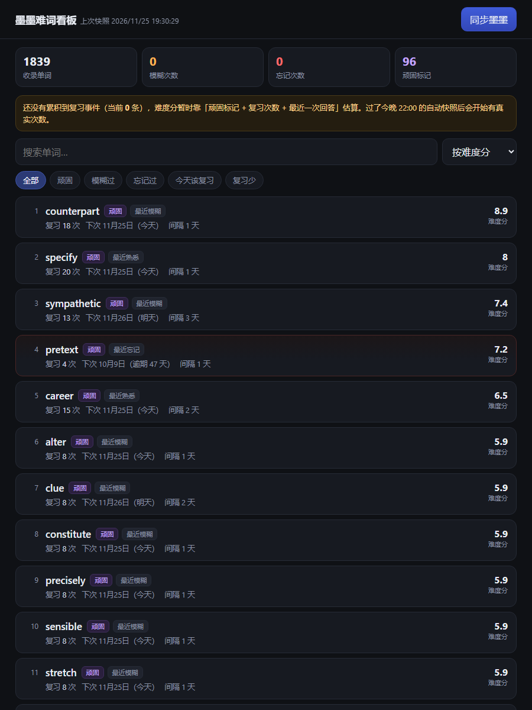

# 墨墨难词看板 · maimemo-dashboard

用[墨墨背单词开放 API](https://open.maimemo.com)的本地快照，统计「哪些词最容易忘」，网页版手机电脑都能看。



## 它解决什么问题

墨墨开放 API 的 `study records` 对每个词只返回两个信息：

- `study_count`：累计复习了多少次
- `last_response`：**最近一次**的回答（`FAMILIAR` / `VAGUE` / `FORGET` / `WELL_FAMILIAR`）

**没有逐次历史接口**，也就是说 API 不会告诉你「这个词你模糊过几次」。所以「遗忘次数」只能自己攒：

1. 每天抓一次全量学习记录，存成 `state.json`；
2. 和上一次对比，`study_count` 变大了就说明学过，把当时的 `last_response` 记成一条事件；
3. 事件越攒越多，就得到了每个词的模糊/忘记次数。

看板读的就是这两份本地数据。

## 功能

- **难度分排行**：模糊、忘记、顽固标记、复习次数综合打分
- **搜索 / 筛选 / 排序**：顽固、模糊过、忘记过、今天该复习、复习少；按难度分 / 模糊 / 忘记 / 复习次数 / 到期时间 / 字母
- **一键同步**：点按钮后台跑一次快照，完成后自动刷新
- **手机适配**：响应式布局，同一 Wi-Fi 下手机直接开

## 快速开始

需要：Windows + PowerShell 5.1 以上 + Node.js 18+。

```powershell
# 1. 安装墨墨官方 CLI
npm install -g @maimemo/memo-api

# 2. 配置 Token（二选一）
#    环境变量：MAIMEMO_API_TOKEN=你的token
#    或写进 %USERPROFILE%\.config\memo-api.json：{"apiToken":"你的token"}
#    注意：这个文件不能带 UTF-8 BOM，否则 Node 解析失败、CLI 会一直报「缺少 API Token」

# 3. 建基线（第一次只记录当前状态，不产生事件）
powershell -NoProfile -ExecutionPolicy Bypass -File .\memo-history.ps1 snapshot

# 4. 启动看板
node .\app\server.mjs
# 或者双击 app\start.cmd

# 5. 打开
#    http://localhost:8787
```

## 目录结构

```
.
├── memo-history.ps1      # 抓取 + 差分 + 统计（snapshot / report / status）
├── app/
│   ├── server.mjs        # 零依赖 Node 服务：/api/data、/api/sync
│   ├── index.html        # 单页界面（内联 CSS/JS，无外部依赖）
│   ├── start.cmd         # 启动看板
│   └── allow-lan.cmd     # 需要时放行 8787 端口（要管理员）
├── docs/
│   └── maimemo-api-notes.md
├── state.json            # 运行时生成，不进仓库
└── events.jsonl          # 运行时生成，不进仓库
```

## 常用命令

```powershell
$s = '.\memo-history.ps1'
powershell -NoProfile -ExecutionPolicy Bypass -File $s snapshot        # 抓一次并记事件
powershell -NoProfile -ExecutionPolicy Bypass -File $s report -Top 30  # 命令行看排行
powershell -NoProfile -ExecutionPolicy Bypass -File $s status          # 看攒了多少
```

数据默认写在脚本同目录，可用 `-DataDir` 或环境变量 `MAIMEMO_HISTORY_DIR` 改到别处。

## 每天自动快照

```bat
schtasks /Create /SC DAILY /ST 22:00 /TN "MaimemoSnapshot" ^
  /TR "powershell -NoProfile -ExecutionPolicy Bypass -File \"C:\path\to\memo-history.ps1\" snapshot"
```

## 难度分怎么算

```
难度分 = 模糊×3 + 忘记×6 + 顽固标记×2 + min(复习次数, 25)×0.3
       + 最近一次为「模糊」+1.5 / 为「忘记」+4 / 为「很熟」-1
```

事件还没攒够时（刚建完基线），分数主要靠「顽固标记 + 复习次数 + 最近一次回答」估算，看板顶部会给出提示。

## 已知局限

- **两次快照之间的多轮复习只保留最后一轮的回答**：如果一天复习了 5 次，脚本只能知道第 5 次的结果，中间几轮记为 `UNKNOWN`。想更细就提高快照频率。
- **历史不可回溯**：从这个工具开始运行那天起才有数据，之前的模糊/忘记次数补不回来。
- **依赖墨墨 API 的限流**：脚本遇到 `common_too_many_request` 会退避重试；拉到的词数低于上次 90% 时直接中止，不覆盖已有数据。

## 数据与隐私

所有数据都留在本地，不上传任何地方。`state.json`、`events.jsonl` 已在 `.gitignore` 中排除——里面有你的完整词表和复习记录，别提交。

## License

MIT